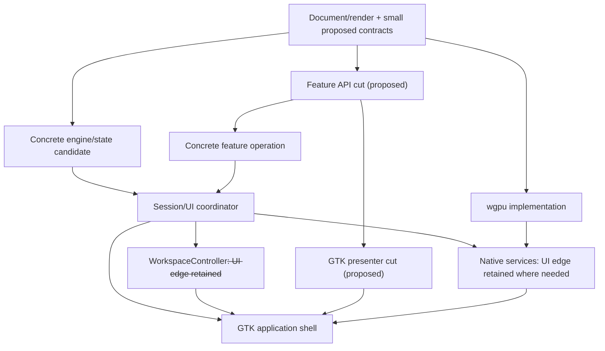

# Stable Rust incremental build plan

[Developer guide](README.md) · [Architecture](../architecture.md)

**Status: deferred until after the next release ships.** Do not start profiling,
harness changes, profile changes or architectural work for the current release.
This document preserves the plan for later; it does not authorize execution now.

After that release, resume with Stage A/B measurements and the necessary
profiling-harness extensions, including temporary source probes and
invocation-local profile overrides. Use task-owned isolated targets and
snapshots on the scratch SSD under the [environment rules](environment.md).
Restore probes and delete owned snapshots/targets after retaining small reports
and patches. Do not commit source changes or change profile/launcher
defaults as part of those experiments. Stage C architectural implementation is a
separate decision based on their results.

## Goal and success contract

Halve elapsed time for realistic Linux incremental app builds, including features
that change Rust core, engine, shared UI and GTK together, using stable Rust and
preserving application behavior and runtime performance.

The primary workload is an exact warmed-parent → changed-source transition:

```text
cargo build --offline --locked --profile dev-perf -p layer-linux --timings
```

Acceptance compares fresh, matched baseline/candidate runs of the 16-change
[reference workload](#reference-workload). Historical local timings motivate the
plan; they are not an acceptance baseline for a later compiler, machine or source
revision. Reestablish the baseline after the release.

**Declare the goal achieved only when both the matched median and aggregate
elapsed-time ratios are at most 0.50**, with per-change paired results reported,
repeatable case regressions resolved, and required runtime/correctness gates met.
For repetitions, first summarize each case/variant by its confirmation median;
compute the workload median and sum from those per-case values. Also retain all
raw runs and per-block aggregate ratios. Do not pool selected screening runs into
confirmation or conceal regressions in an aggregate.

A smaller result can justify retaining a small useful change. It does not by
itself justify the complete ownership/feature-crate migration. A broad migration
requires evidence on representative edits and a quantified remaining path to the
goal; the destination diagram is not that evidence. No broad migration follows
automatically from a positive pilot.

Test, check and release journey **build times** are outside the primary timing
objective. Their required correctness/runtime checks still apply to eventual
source changes. Do not turn this into a separate test-placement or journey-profile
optimization project. Nightly parallel frontend, `RUSTC_BOOTSTRAP` and `-Z`
diagnostics are not part of the measurement/configuration plan.

## Questions to resolve

The earlier investigation identified both long metadata dependency chains and
substantial downstream code generation. A backend-only change need not remove
the frontend chain, and accelerating GTK can expose a competing host/workspace
branch. Reconstruct those paths before choosing a source boundary. No source
boundary has demonstrated the remaining gain; expect partial progress rather
than treating 2× as a forecast.

Source pointers describe the reference revision
`867f88fbfd1ac8a642817a47ecdcaeff3eddf7a3`. Recheck them against the post-release
code before resuming. Proposed types/crates are illustrative, not verified
implementations or a promise of a particular speedup.

| Hypothesis | What is established / missing |
| --- | --- |
| Renderer specialization propagates expensive editor work | Generic session/engine ownership exists. Its removable CPU/time share is unmeasured. Store, callback, toolkit generics and ordinary revalidation are alternatives. |
| CGU reuse/local ThinLTO causes the backend tail | Regeneration counts and the cause are unknown. Configuration comparisons test utility first. |
| Wide shared types drive frontend propagation | Layout, derives, imported bodies, trait queries and cache validation are competing mechanisms for downstream frontend work. |
| Source-line shifts broaden codegen invalidation | `dev-perf` retains line tables; emitted debug locations and panic caller-location constants can change below an insertion, including downstream generic instantiations. The amount of regenerated work and its elapsed cost are unmeasured. |
| Codec specialization is a useful small extraction | A generic AVIF export path and codec symbols exist. Optimizer cost/payoff is unmeasured. |
| Boxing/state privacy stops invalidation | It may stabilize parent layouts; it does not hide every drop, auto-trait, metadata or query dependency. |

CPU shares measure concurrent work, not elapsed-time percentages or removable
application function costs. Symbol names establish presence, not optimizer cost.
Timing/CPU traces, model outputs and review records belong in ignored artifacts;
do not depend on those files being available in another checkout. A model that
reproduces its input timings does not validate counterfactual speedups. Case 09
is an example edit, not a GTK compile-time floor. Cases 04/10 change GTK tests,
despite no production GTK edit.

## One action sequence

0. Freeze the measurement contract below and inventory **one** feature's actual
   types, state owners, callbacks and GTK services read-only. This is bounded
   preparation, not a commitment to split that feature.
1. Screen the fixed Stage A configuration matrix, then independently confirm at
   most one candidate against fresh baseline blocks. A null/inconclusive result
   ends this screen; it does not trigger unlimited setting permutations.
2. Choose one material residual question from actual frontend/backend completion
   paths. If frontend propagation or source-location invalidation is actionable,
   use Stage B's calibrated contrast. Otherwise inspect one small supported
   extraction read-only instead of automatically running every probe. End this
   post-release investigation with the Stage A/B results and the next bounded
   proposal.
3. If subsequently authorized, test **one** Stage C source boundary, keeping
   current owners where possible. Measure the defining crate as well as
   consumers. Accept useful small changes on their measured merit; stop that
   hypothesis if work merely moves onto
   another critical branch or the gain does not repeat.
4. Freeze a successful candidate and validate it on fresh matched reference-mix
   runs or documented faithful equivalents. Report screening, pilot confirmation
   and remaining validation cases separately as well as together. Apply the
   explicit success and runtime gates before claiming a 2× improvement.
   End with a report of the measured gain, per-case results, remaining critical
   path and gap to the goal, even if the result is partial or inconclusive.
   Do not automatically expand the migration or extend sampling to reach 2×.

## Measurement contract

Each variant has an isolated, stable target namespace with the same compiler,
features, source paths and unrelated settings across its parent/child pair.
Record all source patches/hashes, commands, actual compiler flags, wrapper hash,
cache provenance, machine load, units executed and third-party compilation.
Preserve Cargo jobserver descriptors in the pass-through compiler wrapper.

A repetition starts from an equivalent warmed-parent state, not a return to an
already-built child. Use a complete isolated snapshot/copy or demonstrate an
equivalent procedure. Do not overlay child leftovers or hard-link mutable cache
files. Keep heavy snapshots/builds on scratch SSD, after compiler processes exit.
On the reported reflink-capable XFS volume at `/mnt/localssd`, prefer
`cp -a --reflink=always` snapshots of the source tree and target together. Verify
reflink support on the execution mount; these copy-on-write copies preserve
timestamps and initially share file data, but later writes still consume space.
Restore into the same recorded working paths before running Cargo rather than
assuming a relocated copy is cache-equivalent. The unchanged-parent check below
remains mandatory. Track and delete only task-owned copies/targets after retaining
reports; snapshot creation is preparation, outside measured elapsed time.

For every repetition:

1. Restore parent source/cache state and preserve timestamp/path relationships
   where possible. Verify the exact source, flags and namespace.
2. Run an unchanged-parent check outside measured time; it must compile no units.
   If restoration causes compilation, reestablish and record the warmed parent.
3. Verify no prior child namespace/work product contaminates the intended first
   forward transition. This includes dependency/profile namespace changes.
4. Apply and verify the intended patch, then record actual child invocations and
   expected units for that variant's graph. Unexpected skipped compilation or
   unrelated rebuilds invalidates the comparison until explained.

Record per workspace unit: start, frontend duration until metadata, metadata-ready
time relative to Cargo start, completion, codegen/tail and user/system CPU. Mark
metadata unavailable for units that do not produce that milestone. Reconstruct
all competing branches and keep dispatch/executable overhead separate.

Use ordinary unsampled runs for elapsed-time claims. CPU samples, `-C save-temps`
and extra object/LLVM-output attribution use separate, consistently prepared
parent/child namespaces. Equal object bytes do not prove codegen reuse. Mark
unavailable reused-CGU/query/function-optimizer counts honestly. Filesystem cache,
contention and instrumentation still limit inference despite these controls.

Historical source edits need faithful adaptations after structural changes.
Preserve their behavioral intent and affected layers, record every adapted patch,
and compare baseline/prototype from the same feature state. Synthetic probes are
never included in the real-workload success median or aggregate.

## Stage A: fixed screen and independent confirmation

Use [reference cases](#reference-workload) 09 (GTK-only production edit), 14
(small shared UI edit), 01 (broad change) and 11 (a long frontend chain). The first pass screens four variants
at opt3, with counterbalanced order:

| Variant | CGU scope | LTO scope |
| --- | --- | --- |
| Baseline | Original profile/package settings | Original inherited setting |
| CGU256 | Explicit per-workspace-package `codegen-units = 256` overrides; retain non-workspace CGUs | Original inherited setting |
| LTO off | Original CGUs | Profile-wide `profile.dev-perf.lto = "off"`; warm all affected dependencies |
| Both | Same workspace-package overrides | Same profile-wide LTO override |

Do not substitute a global CGU change or package-local LTO: Cargo does not allow
package LTO overrides. Record exact flags, including dependency effects. These
settings primarily target backend work, but measure frontend effects rather than
assuming they are zero. Generate overrides for every workspace package on the
revision being built, including platform packages, rather than hard-coding an
old package list. Use Cargo config overrides for the experiment; do not edit
profile defaults. Exact reused-unit counts are optional.

**Selection rule fixed before screening:** rank eligible variants by aggregate
elapsed-time ratio across the four cases; select at most one candidate for
confirmation. Eligibility requires valid runs for all four cases. Exclude
known-invalid source/flags/cache runs. Screening supplies selection evidence only
and is excluded from the accepted timing estimate.
Do not declare a winner from one favorable trial.

**Confirmation rule:** run baseline and the selected candidate in three fresh,
paired blocks for each of the same four cases, counterbalancing which runs first
across blocks/cases. Restore parent state for every run. Rerun baseline in every
block and report all runs, per-case paired ratios and per-block aggregate ratios.
Before screening, fix this numerical decision rule: let `B_b` and `C_b` be the
summed baseline/candidate elapsed times across the cases in block `b`, and let
`v = (max(B_b) - min(B_b)) / median(B_b)` across the three blocks. Require
`1 - C_b / B_b > v` in **each** block: the candidate must win all three by more
than the observed fractional baseline range. Otherwise label it inconclusive
and retain baseline. This is a conservative decision heuristic, not a confidence
interval or proof of a universal effect; report the raw values and threshold.
Do not add repeats until the candidate wins. Further sampling needs a distinct
stated question and a fixed new budget. Runtime rejection also retains baseline.

Freeze any accepted configuration before later attribution/source comparisons.
Independent representative-workload validation uses new observations; retain the
selection/confirmation/remaining-case breakdown rather than pooling selected
fast observations into the final claim. Compare source candidates against both
the original baseline and the frozen accepted configuration.

A bounded opt1 comparison remains optional because generic sharing differs from
opt2/opt3; it is a separate question, not an automatic additional sweep. Do not
schedule a second LTO screen. Runtime qualification uses the actual app built
with proposed iteration settings, not only a release build.

`dev-perf` is also used by Android debug and Web launch/build paths. A Linux-only
experiment does not change them. "Linux-scoped adoption" means a separate named
Cargo profile selected by the GTK launcher (`CAPY_RUST_PROFILE`/`--profile`), not
a target-specific Cargo profile: profiles cannot be scoped to a target. Its
eventual definition must retain the intended dependency overrides explicitly.
Prefer that scope for this goal; if global shared defaults change, qualify all
affected configurations or do not adopt globally. Update the
[profile guide](environment.md#build-profiles)
when an eventual implementation adopts a setting.

Compiler semantics:
[profiles/LTO/generic sharing](https://doc.rust-lang.org/cargo/reference/profiles.html),
[Cargo timing boundaries](https://doc.rust-lang.org/cargo/reference/timings.html).

## Stage B: one question-driven invalidation contrast

Run this only if residual frontend propagation or source-location invalidation
is a material decision. Start on one fixed source revision and the frozen useful
configuration, or baseline if none is accepted. Use the same UI source file for
these first contrasts:

| Contrast | Purpose and validity condition |
| --- | --- |
| Fresh unchanged-parent no-op | Proves Cargo freshness; zero executed units is expected. It does not measure the cost of an invoked rustc. |
| Same-bytes forced rebuild | Change only source timestamp to force Cargo to consider the file dirty while preserving its bytes and compiler caches. Verify which rustc units actually execute. A control that skips a relevant downstream unit is inconclusive for that unit, not evidence of zero frontend cost. |
| One reachable body edit | Compare with the forced control in the same file. Record visibility, generic context, inline/const exposure, callers and every changed path. Prefer an existing concrete out-of-line helper if testing signature-independent propagation; private `UiSession<R>` methods remain generic. |
| Same body edit, preserved versus shifted lines | Apply the identical semantic body change from the same warmed parent, once preserving existing downstream line/column positions and once adding a fixed, recorded number of blank lines before it. Keep tokens/items otherwise identical; compare per-unit frontend and backend work, including GTK/host. Use isolated namespaces and the same fixed paired-block sampling/order discipline; report signed differences rather than select the faster synthetic edit. This tests sensitivity to source locations, not a guaranteed compiler mechanism. |

The forced control measures a particular green/revalidation execution, not a
fixed per-crate floor. File touching is acceptable only if it triggers the
intended units without changing code/flags or deleting compiler caches; otherwise
report the control as uninformative and choose another bounded control/source
comparison. Never silently replace it with a clean build.

For the line-shift hypothesis, distinguish debug metadata from machine
instructions. [Line-table debug info](https://doc.rust-lang.org/rustc/codegen-options/#debuginfo)
records source positions; [panic caller locations](https://rustc-dev-guide.rust-lang.org/backend/implicit-caller-location.html)
can also be emitted as constants/hidden call arguments for `unwrap`, `expect`,
indexing and panic paths, independently of debug info. Shifts may invalidate
codegen units or downstream monomorphizations, but do not establish that every
function below an insertion regenerates. Optimization and incremental reuse can
change the outcome. This is a plausible, unmeasured cause here, not a timing
conclusion inferred from compiler documentation.

[session.rs](../../crates/layer-ui/src/session.rs) is a large source file at the
reference revision, and case 14 inserts/removes production lines early in its
generic `UiSession<R>` implementation as well as changing behavior. It is motivation,
not an isolated line-shift experiment. Repeat the paired contrast with debug
info disabled in a separately warmed configuration to distinguish the debug-info
contribution; the harness's existing `incremental-debug0` setting is a starting
point, not a substitute for adding this UI probe. Verify actual flags and keep
all other settings fixed. Debug0 leaves panic-location effects and other span
dependencies possible, so a residual difference is not uniquely attributed to
panic locations. If line shifts materially cost time, propose a paired test of
splitting the large file into smaller source modules **within the same crate**
before considering additional crates. A module split does not guarantee a new
CGU boundary or remove frontend dependency edges; measure the benefit.

Add a `UiState` shape contrast **only** if wide shared-type exposure remains a
live boundary decision. Record initializer, `Clone`/`Debug`/`Serialize`, layout,
move/drop and generic serialization changes. Add a private-shape or derive-only
contrast only when needed for that precise question. A shape result does not
uniquely identify layout invalidation. Large or similar totals do not establish
one cause; separate CPU categories and an actual small boundary comparison must
support the interpretation. If controls do not discriminate, say so and proceed
to a bounded source comparison rather than accumulating probes.

The existing [core threshold harness](../../tools/build/profile-rust-incremental.py)
changes `0.04045` to `0.04046` in concrete `RgbSpace::decode`, preserving types and
signatures. It is a foundational body-edit comparison, not a control for a UI
function and not a representative feature workload. Reuse its anchor/restoration
logic rather than introducing another benchmark framework.

A harness extension must handle every modified path, explicit isolated targets,
metadata/resources and the cache contract above. The current script fixes one
source/target path, rejects wrapper/target environment overrides and alternates
source directions. Its defaults do not supply these stronger guarantees. Capture
all original contents/hashes, restore every owned edit on completion/failure, and
refuse to overwrite an unexpected concurrent edit. Multi-file shape probes need
multi-file restoration. Extending the harness to implement these controls is
part of Stage B when the post-release investigation resumes, not current work.

## Stage C: one source boundary selected by evidence

Do not mandate one change per phase or select the controller before the earlier
decisions. A change may improve both phases. Choose the smallest candidate that
addresses the measured residual path and can be falsified by an isolated paired
comparison. Keep the same current owners for the first extraction where possible.

| Candidate | Source evidence, experiment and failure condition |
| --- | --- |
| Concrete editor operation | [Effects](../../crates/layer-ui/src/effects.rs) in its generic session impl is substantial and cross-cutting. Keep existing admission/undo and move one operation into a concrete controller with a narrow borrowed capability. Reject this extraction as a speed route if reduced consumer emission merely reappears on the defining-crate critical path or elapsed improvement does not repeat. Many view builders and `DabGenerator` are already concrete; moving those alone does not test renderer erasure. |
| Concrete codec helper | The export chain through [host output](../../crates/layer-host/src/export.rs), [snapshot output](../../crates/layer-render-wgpu/src/snapshot/output.rs), [gain-map output](../../crates/layer-color/src/photo/gainmap.rs) reaches [callback-generic AVIF encoding](../../crates/layer-color/src/photo/avif_io/encode.rs). Keep generic frame-population loops, then pass the existing filled frames/context into concrete encoding helpers. No second image buffer or per-pixel virtual call. Verify actual emission and whole-build time; preserve budget, cancellation, color metadata, lossless roundtrip and export throughput/memory. |
| Narrow view/contracts or within-crate analysis | A calibrated body/shape result may support reducing shared-type exposure, generic/trait/derive work or query dependencies. Validate on real edits; if probe gains disappear on broad changes, do not use the probe to predict workload gains. Boxing/private fields alone do not prove opacity. |
| Native services/facade split | GTK uses host services without constructing `NativeHost`, but the whole crate's CPU cost is not all removable. Select only if the current host path warrants it. Services retain work and UI types; demonstrate the actual cut before claiming shorter metadata chains. |
| Feature/GTK presenter crates | Potentially reduce exposure and supply sibling frontends. Actual API/callback edges must be cut; splitting files alone does not create useful parallel work. Compare against useful configuration and smaller extractions; duplicate toolkit metadata/generics may offset savings. |

Stable symbol/object/IR inspection can show emission and changed products, not
optimizer time by application function. A controlled source comparison can supply
causal evidence even when stable tooling cannot produce exact query timings.
Preserve existing method names where helpful, without exporting the heavy generic
body through inline forwarding or dereference shortcuts.

For native services, split functions/ownership paths rather than whole modules:

| Area | Existing mixed responsibility |
| --- | --- |
| [tasks](../../crates/layer-host/src/tasks.rs) | Pure capture helpers coexist with concrete session/facade color/source capture, preparation, adoption and device validation. |
| [clipboard](../../crates/layer-host/src/clipboard.rs) | `capture` takes the AttachedRenderer session; `new<R>` is GTK's generic path and does not itself force the facade. |
| [papers](../../crates/layer-host/src/papers.rs) | Library work coexists with session capture/apply and `PaperTask::apply(&mut NativeHost, ...)`. |
| [export](../../crates/layer-host/src/export.rs) | File-output helpers coexist with `ExportTask::capture(&UiSession<Renderer>, ...)`. |
| [GPU/storage](../../crates/layer-host/src/gpu.rs) | Retained services still use UI types and have device/error/publication contracts. |

Keep capture/adoption in the proper shared controller/facade, with concrete
captured inputs/results for services. Moving task types may require facade free
functions or owned wrappers instead of foreign inherent impls. Do not duplicate
work pipelines. Verify normal Linux dependencies no longer reach the intended
facade paths, then measure retained services and competing branches.

## Ownership and protocol gate for a stronger migration

The following is a candidate direction, not the first experiment or a proven
implementation. Substantial behavior becomes concrete; only a small owner knows
the backend type. One possible shape uses a lifetime-only execution view:

```rust
struct CanvasOwner<R> {
    state: Box<SessionState>,
    renderer: R,
}

struct EditorSession<'a> {
    state: &'a mut SessionState,
    renderer: &'a mut dyn CanvasRenderer<Error = RenderError>,
}
```

State and renderer remain private and paired. Construct the view only inside an
owner operation; it does not escape or become a stored self-reference/raw pointer.
Do not expose `engine.step(any_renderer)` or allow renderer-specific services to
silently swap a backend. The current synchronous shared submission algorithm is
the starting point. A static generic driver is an alternative only if an explicit
linear submission protocol preserves readiness, pending frames, retry and final
publication; do not distribute that policy among hosts.

### Storage location is not semantic ownership

The session currently stores both document-owned state and replicas of window
state. Preserve [inherit_window_state](../../crates/layer-ui/src/renderer_lifecycle.rs)
and its activation behavior before centralizing any owner:

| State | Required ownership/activation semantics |
| --- | --- |
| Document, camera, drawing tools, artwork undo/checkpoint/color | Retain the drawing's state when it is parked/reactivated; new-drawing tool inheritance follows its separate existing operation. |
| Workspace layout/history/binding/read-only state, tool slots/settings and window presentation context | Stored in sessions today but brought forward from the previously active session during tab activation. Do not resurrect a parked tab's stale window layout/history/binding. |
| Customization interaction | Activation resets transient customization in the existing protocol; do not make it an independently persistent transaction for every document. |
| Workspace persistence/controller | `WorkspaceController<S>` stays window/application scoped beside document owners, with store leases, renewals and acknowledged close/save. |

The initial prototype keeps these state replicas and transfer protocol; a
centralized window-state redesign is a separate hypothesis. Preserve viewport,
camera/input generation and layout/history inheritance across tab activation.
`WorkspaceStore` has an async method and is not directly replaced with a stable
trait object. Retain the store generic and browser non-`Send` operation; do not
move its `Rc` state into a native owner that needs to be movable.

### Error normalization must preserve the whole renderer protocol

The borrowed `CanvasRenderer<Error = RenderError>` form appears dyn-compatible
by source inspection; compilation/lifetime integration remains unverified.
Prefer normalizing errors in existing implementations if that keeps the chosen
experiment smaller. If an adapter is needed, a compiling required-method/error
forwarder is **insufficient** because most renderer methods have defaults.

Require an inventory covering every trait method and backend override, including
readiness/capacity, capabilities, context/seed, pending submissions, cancellation,
requests, nested `Option<Result<...>>` results and one-shot completion. Forward
to the underlying receiver's actual implementation rather than accidentally
using adapter defaults. For example, default `can_submit()` is true and default
context is empty; those cannot replace the worker's mailbox/context behavior.

Gate the adapter on direct-versus-wrapped protocol tests for backpressure,
pending/multi-step frames, evaluation context, cancellation and one-shot results.
Cover the behavior of [AttachedRenderer](../../crates/layer-render-wgpu/src/attached.rs)
and [RenderWorker](../../apps/layer-linux/src/render_thread.rs), and review forwarding
again if the trait grows. Avoid backend downcasts, new hot-path locks, per-input
allocations and pixel copies as shortcuts.

### Lifecycle and async preservation

- A prepared frame stays with its renderer. The private owner mediates candidate
  preparation, pending-frame rejection, color/context validation, swap and
  generation changes using the current engine/session lifecycle. Healthy parking,
  renderer replacement and failed-device recovery have different transitions.
- Retain single-consumer/canceller ownership for snapshot, bounds, analysis and
  region channels. Some completions have no request ID, and default bounds
  cancellation delegates to snapshot cancellation; IDs alone are insufficient.
- Retry accepted unfinished thumbnails under their original IDs after replacement
  before new work. Do not blanket-discard every old-generation request.
- Preserve capture barriers, immutable roots, integrated animation/effect context
  from successful submission, and native device identity during asynchronous
  preparation/adoption. Blocking capture stays on file workers.
- Preserve ordered deferred actions and pen samples, original targets,
  camera/brush capture, bounded queues, prediction/correction handling, completed
  versus incomplete contact expiry and Undo order. No independent feature queues
  may bypass this shared admission/publication owner.
- GTK setters/callbacks can synchronously reenter the editor. Release `RefCell`
  guards before setters/callbacks. Native timing/input/surfaces remain in hosts;
  policy, validation, undo and UI text remain shared Rust. Web retains its event
  loop without new thread or `Send`/`Sync` requirements.

Source gates: [engine](../../crates/layer-engine/src/canvas.rs),
[renderer lifecycle](../../crates/layer-ui/src/renderer_lifecycle.rs),
[deferred edits](../../crates/layer-ui/src/deferred_edits.rs),
[effect analysis](../../crates/layer-ui/src/effect_analysis.rs),
[native tasks](../../crates/layer-host/src/tasks.rs),
[Linux integration rules](linux.md).

## Dependency gate before feature/GTK crates

For one selected feature, identify contracts, localization, shared controls,
action sink, view snapshots, preview transport and exact state owners. GTK
[effects](../../apps/layer-linux/src/effects.rs) currently takes `Workspace`/`UiState`
and several controls also need the full workspace. Keeping those imports creates
a back-edge; moving every shared widget into the feature merely hides one.
A presenter should receive concrete/dynamically dispatched action/view services,
not become generic over the complete caller. A small API crate is justified
only when it removes a meaningful metadata edge or preserves reuse.

The illustrative graph below **retains** the session → window-workspace UI edge.
Removing it requires a separately specified contract cut for `UiSession`,
localization and workspace types, including `WorkspaceWorkingState` in store
mutations. Renderer erasure or an adjustment split does not perform that cut.
Likewise, services that still use UI types retain a UI metadata dependency.
No persistence migration is required for a Stage C experiment.

Arrows run from prerequisites to consumers. Feature/API nodes are proposed cuts,
not already-independent folders; existing workspace/service UI dependencies are
shown explicitly:



Keep heavy methods concrete/out of line where the compile boundary needs it.
Private/boxed state does not promise a stable Rust ABI or query opacity. Separate
GTK crates may repeat metadata/generic work or reduce duplicate implementation
work; measure total CPU, memory and elapsed time against useful configuration
and smaller alternatives. A longer chain of tightly coupled crates may regress.

## Representative validation and runtime acceptance

After pilot confirmation/source experiments, freeze the candidate before new
reference-mix measurements. Use all 16 historical transitions or faithful,
recorded structural equivalents; include renderer-heavy and broad changes, not
only cases selected for screening. Keep exploratory/pilot observations separate
from fresh acceptance observations. Report each-case ratios, both workload
ratios, remaining critical paths, CPU, variability and every failure/regression.
A four-case pilot median is not comparable to the old 16-case median.

Stage C source confirmation and final 16-case acceptance each use three fresh
paired blocks per case/comparison, with the relevant baseline rerun in every
block and order counterbalanced across blocks/cases. Apply Stage A's exclusion,
inconclusive-result and no-optional-stopping rules to both; selected exploratory
runs do not enter their accepted estimates. Freeze this budget before each
confirmation, rather than expanding it until an improvement appears.

Qualify the actual app/profile whose iteration experience is claimed plus required
release/benchmark measurements. No new functional regression is acceptable.
Reproducible performance regressions must be resolved before default adoption;
report baseline variability and pre-existing target misses rather than claiming
unmeasured targets are met. Checks follow [testing](testing.md),
[performance targets](../PERFORMANCE_TARGETS.md) and
[measurement rules](../performance/measuring.md).

Scope runtime checks to the changed mechanism while satisfying host rules:
codec helpers need export/cancellation/lossless/peak-memory checks; controllers
need gesture commit/cancel and ordered input/Undo; renderer changes need the
protocol/lifecycle gate above and affected host journeys. A faster release build
alone does not qualify an opt1 development build. Input/UI threads must not gain
GPU waits, blocking I/O, decodes or pixel copies.

## Reference workload

Each case independently replays its child commit's first-parent transition:
`<child>^` → `<child>`. These are selected changes, not consecutive commits;
never use the previous table row as the next case's parent. Read a case with
`git show <child>` and check its manifest/features as well as Rust edits. Case 16
changes build topology and needs its own fully warmed parent namespace; a
return to previously cached child artifacts is not a first forward application.

After source restructuring, record faithful equivalents with the same feature
intent and affected layers. Recreate parent freshness checks and compiler flag
records rather than relying on missing local reports. Preserve the complete
workload definition and raw results in ignored artifacts when execution resumes.

| Case | Child commit | Change |
| --- | --- | --- |
| 01 | `df376a3ea4ab` | Replace Liquify feedback with retained deformation and source reconstruction |
| 02 | `2b419699ec6c` | Open fresh drawings at display height on every platform |
| 03 | `601106ba6fcc` | Keep vector edits, scrubs, pinches and bakes responsive on the tablets |
| 04 | `937b67d499e0` | Make vector erasing and picking follow the visible stroke |
| 05 | `504876550f40` | Preserve source colors when blending with Dither |
| 06 | `49dc17573d16` | Remove the Edge-Keeping Blender from every client |
| 07 | `3d7f110c8e42` | Take tools, brushes, sliders, Color and Layers onto the canvas as bubbles |
| 08 | `e1cc1d14f5c9` | Rebuild tool bubbles to the approved shapes and flows |
| 09 | `5a00f64d2224` | Share GTK bubble wheel color transactions |
| 10 | `dbdaab756c8a` | Clear the active layer with a three-finger scrub at any angle |
| 11 | `26f7fb3f2ce5` | Add GTK HDR color bubbles and dismiss drawers on pickup |
| 12 | `f8b0bc7a58e8` | Complete dry-media endpoints and turns without changing stroke buildup |
| 13 | `9bb23c036809` | Normalize stylus tilt and make dry side shading reachable |
| 14 | `889e89b146da` | Let Escape leave Zen mode |
| 15 | `da29cf32416e` | Expose Preferences at the bottom of compact menus |
| 16 | `867f88fbfd1a` | Stop loading opaque driver caches and admit Web files before acquisition |

## Completion

End each bounded investigation with the measured per-case elapsed times and
ratios, median/aggregate ratios, variability, remaining critical paths, the gap
to 2× and a recommendation to retain, reject or investigate one specific next
change. A partial or inconclusive result is a valid stopping point. Do not start
a broad migration to make the result match the target. Remove this temporary
plan when the work lands; move lasting build guidance into the environment guide.
